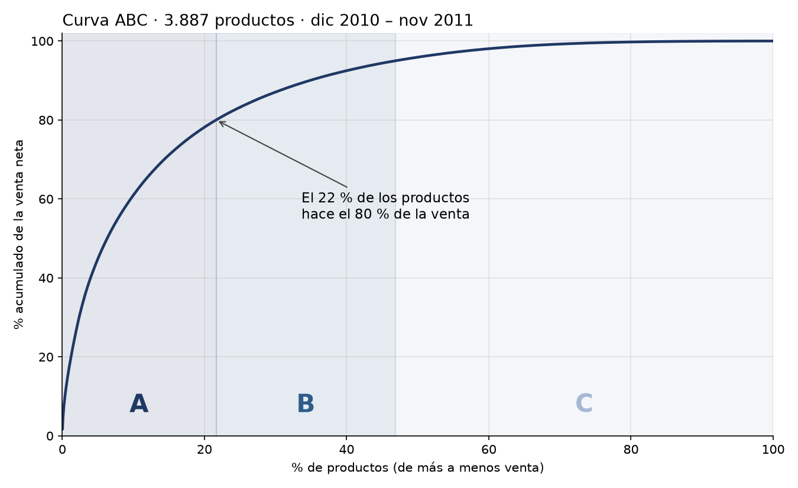

# Inventario ABC: qué productos merecen más atención

Clasificación ABC de casi 3.900 productos de una tienda real, hecha con SQL y Python sobre
un año de ventas (más de un millón de líneas de factura).

Es el primer paso de un método que apliqué en mi trabajo. En un almacén de más de
60.000 referencias sin datos fiables, reclasifiqué el stock por rotación y fijé máximos y
mínimos por referencia. Aquí reproduzco el método con datos públicos para que se pueda
revisar de principio a fin.

## Resultado



| Clase | Productos | % de productos | Venta neta | % de la venta |
|---|---:|---:|---:|---:|
| A | 841 | 21,6 % | 7.803.103 £ | 80,0 % |
| B | 981 | 25,2 % | 1.463.182 £ | 15,0 % |
| C | 2.065 | 53,1 % | 487.397 £ | 5,0 % |

**Uno de cada cinco productos hace el 80 % de la venta.** Esos 841 son los que no pueden
quedarse sin stock. Más de la mitad del catálogo (clase C) solo aporta el 5 %: ahí es donde
suele acumularse el stock que no sale.

El detalle por producto está en [`resultados/clasificacion_abc.xlsx`](resultados/clasificacion_abc.xlsx),
con filtros, para trabajarlo directamente en Excel.

## Lo que un análisis rápido habría hecho mal

El 18-01-2011 un cliente pidió **74.215 tarros de cerámica** y anuló el pedido 16 minutos
después. Si se borran las anulaciones sin más, el pedido original sigue contando y ese tarro
aparece como el **quinto producto más vendido del año**, con 81.000 £. Con las anulaciones
restadas, su venta real fue de 3.969 £.

Por eso aquí se trabaja con **venta neta**: las anulaciones se restan, no se borran. En el
año analizado suman 311.460 £ en 8.668 líneas.

## Cómo se ha hecho

1. **Carga** ([`01_cargar_datos.py`](01_cargar_datos.py)): el Excel original pasa a una base
   de datos SQLite, donde un millón de líneas se consulta en segundos.
2. **Limpieza** ([`sql/01_ventas_limpias.sql`](sql/01_ventas_limpias.sql)): se quitan portes,
   comisiones, descuentos, vales, productos de prueba, mermas y líneas sin precio. Las
   anulaciones se quedan en negativo.
3. **Clasificación** ([`sql/02_abc.sql`](sql/02_abc.sql)): venta neta por producto entre
   diciembre de 2010 y noviembre de 2011 (los últimos 12 meses completos). A hasta el 80 %
   acumulado, B hasta el 95 %, C el resto.
4. **Informe** ([`02_clasificacion_abc.py`](02_clasificacion_abc.py)): genera el Excel y la
   curva.

El resultado se ha comprobado con un segundo cálculo independiente, hecho desde las líneas
originales sin pasar por las consultas SQL. Coinciden los totales y la clase de cada uno de
los 3.887 productos.

## Próximos pasos

- **XYZ**: medir lo estable que es la demanda de cada producto. No es lo mismo un A que se
  vende igual todas las semanas que uno que solo se vende en Navidad.
- **Máximos, mínimos y punto de pedido** por producto, según su clase.
- **Previsión de la demanda** para los productos A.

## Para reproducirlo

Necesita [uv](https://docs.astral.sh/uv/). Descarga los datos desde la UCI y descomprímelos
en `datos/`:

```bash
curl -L -o datos/online_retail_ii.zip "https://archive.ics.uci.edu/static/public/502/online+retail+ii.zip"
unzip datos/online_retail_ii.zip -d datos/
uv run 01_cargar_datos.py
uv run 02_clasificacion_abc.py
```

## Datos

Chen, D. (2012). *Online Retail II* [Dataset]. UCI Machine Learning Repository.
https://doi.org/10.24432/C5CG6D. Licencia
[CC BY 4.0](https://creativecommons.org/licenses/by/4.0/).

Es una tienda online británica de artículos de regalo, sin tienda física; muchos de sus
clientes son mayoristas. Los importes están en libras esterlinas.

---

Gustavo Paz · [LinkedIn](https://linkedin.com/in/gustavopaz08)
