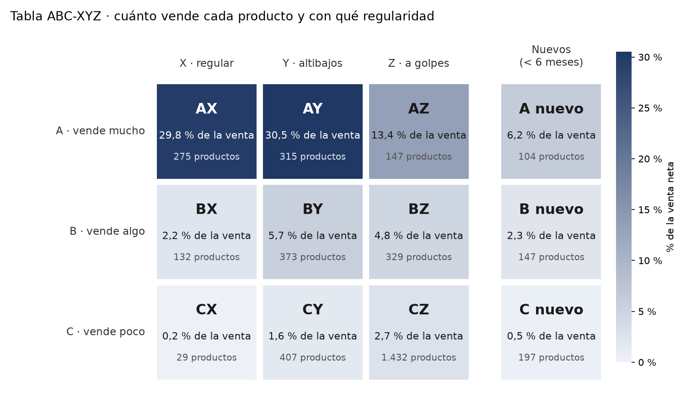

# Inventario: qué productos importan y cómo reponerlos

Clasificación ABC-XYZ de casi 3.900 productos de una tienda real, hecha con SQL y Python
sobre un año de ventas (más de un millón de líneas de factura): cuánto vende cada producto
y con qué regularidad.

Es el primer paso de un método que apliqué en mi trabajo. En un almacén de más de
60.000 referencias sin datos fiables, reclasifiqué el stock por rotación y fijé máximos y
mínimos por referencia. Aquí reproduzco el método con datos públicos para que se pueda
revisar de principio a fin.

## Paso 1: qué productos importan más (ABC)


| Clase | Productos | % de productos | Venta neta | % de la venta |
|---|---:|---:|---:|---:|
| A | 841 | 21,6 % | 7.803.103 £ | 80,0 % |
| B | 981 | 25,2 % | 1.463.182 £ | 15,0 % |
| C | 2.065 | 53,1 % | 487.397 £ | 5,0 % |

**Uno de cada cinco productos hace el 80 % de la venta.** Esos 841 son los que no pueden
quedarse sin stock. Más de la mitad del catálogo (clase C) solo aporta el 5 %: ahí es donde
suele acumularse el stock que no sale.

El detalle por producto está en [`resultados/clasificacion_abc.xlsx`](resultados/clasificacion_abc.xlsx),
con filtros, para trabajarlo directamente en Excel.

## Lo que un análisis rápido habría hecho mal

El 18-01-2011 un cliente pidió **74.215 tarros de cerámica** y anuló el pedido 16 minutos
después. Si se borran las anulaciones sin más, el pedido original sigue contando y ese tarro
aparece como el **quinto producto más vendido del año**, con 81.000 £. Con las anulaciones
restadas, su venta real fue de 3.969 £.

Por eso aquí se trabaja con **venta neta**: las anulaciones se restan, no se borran. En el
año analizado suman 311.460 £ en 8.668 líneas.

## Paso 2: regulares o a golpes (XYZ)

Dos productos de esta tienda vendieron casi lo mismo en el año:

| Producto | Unidades en el año | Febrero | Noviembre |
|---|---:|---:|---:|
| Cápsulas para magdalenas (84991) | 18.413 | 723 | 1.405 |
| Guirnalda de papel navideña (22086) | 18.262 | 5 | 7.868 |

La clasificación ABC no los distingue: los dos son A. Pero las cápsulas se pueden reponer
en automático y la guirnalda no. Si se repone igual, sobra stock de enero a agosto y falta
en Navidad. La clasificación XYZ mide esa diferencia, y al cruzarla con la ABC sale una
tabla de 9 casillas.



**Lo que dice la tabla:**

- **590 productos (el 15 % del catálogo) hacen el 60 % de la venta y se venden de forma
  estable** (AX y AY). Es donde la reposición automática ahorra más trabajo.
- **147 productos venden mucho, pero a golpes** (AZ): el 13 % de la venta. No se pueden dejar
  al automático; necesitan previsión y planificación a mano, sobre todo antes de Navidad.
- **1.432 productos, más de un tercio del catálogo, venden poco y a golpes** (CZ), y solo
  aportan el 2,7 % de la venta. Son los primeros candidatos a liquidar o sacar del catálogo.
- **448 productos llevan menos de 6 meses a la venta** y aún no tienen historia suficiente
  para medirlos. Hacen el 9 % de la venta.

| Casilla | Qué hacer |
|---|---|
| AX | Reposición automática con poco stock de seguridad |
| AY | Reposición automática con más stock de seguridad; revisar cada mes |
| AZ | Planificar a mano con previsión; no reponer en automático |
| BX | Reposición automática |
| BY | Reposición automática con revisión periódica |
| BZ | Pedir por temporada o bajo pedido; stock mínimo |
| CX | Reposición automática, en pedidos grandes y espaciados |
| CY | Revisar de vez en cuando; stock bajo |
| CZ | Candidato a liquidar o sacar del catálogo; pedir solo bajo pedido |
| Nuevos | Vigilar hasta tener 6 meses de ventas |

La casilla y la recomendación de cada producto están en
[`resultados/matriz_abc_xyz.xlsx`](resultados/matriz_abc_xyz.xlsx).

**Cómo se mide.** Con las unidades vendidas cada mes: cuanto más se alejan los meses de la
media, más irregular es el producto (coeficiente de variación: X hasta 0,5, Y hasta 1, Z más
de 1). Se mide por meses y no por semanas porque la tienda cierra en Navidad y en Semana
Santa, y esas semanas casi vacías harían parecer irregular a todo el catálogo. Tres
decisiones cambian el resultado:

- **Los meses sin ventas cuentan como 0.** Si se ignorasen, un producto que solo se vende en
  Navidad parecería estable, porque solo se medirían sus meses buenos.
- **Un mes con más anulaciones que ventas cuenta como 0**, porque la demanda negativa no
  existe.
- **Los productos lanzados durante el año se miden desde su primer mes completo.** Contar
  los meses en que aún no existían los haría parecer irregulares a todos.

## Cómo se ha hecho

1. **Carga** ([`01_cargar_datos.py`](01_cargar_datos.py)): el Excel original pasa a una base
   de datos SQLite, donde un millón de líneas se consulta en segundos.
2. **Limpieza** ([`sql/01_ventas_limpias.sql`](sql/01_ventas_limpias.sql)): se quitan portes,
   comisiones, descuentos, vales, productos de prueba, mermas y líneas sin precio. Las
   anulaciones se quedan en negativo.
3. **Clasificación** ([`sql/02_abc.sql`](sql/02_abc.sql)): venta neta por producto entre
   diciembre de 2010 y noviembre de 2011 (los últimos 12 meses completos). A hasta el 80 %
   acumulado, B hasta el 95 %, C el resto.
4. **Informe ABC** ([`02_clasificacion_abc.py`](02_clasificacion_abc.py)): genera el Excel y
   la curva.
5. **Regularidad** ([`sql/03_xyz.sql`](sql/03_xyz.sql)): unidades por producto y mes, con los
   meses sin venta a 0, y su variación.
6. **Tabla ABC-XYZ** ([`03_matriz_abc_xyz.py`](03_matriz_abc_xyz.py)): cruza las dos
   clasificaciones y genera el Excel y la tabla.

Cada resultado se ha comprobado con un segundo cálculo independiente, hecho desde las líneas
originales sin pasar por las consultas SQL. Coinciden los totales y la clase ABC y XYZ de
cada uno de los 3.887 productos.

## Próximos pasos

- **Máximos, mínimos y punto de pedido** por producto, según su casilla.
- **Previsión de la demanda** para los productos A.

## Para reproducirlo

Necesita [uv](https://docs.astral.sh/uv/). Descarga los datos desde la UCI y descomprímelos
en `datos/`:

```bash
curl -L -o datos/online_retail_ii.zip "https://archive.ics.uci.edu/static/public/502/online+retail+ii.zip"
unzip datos/online_retail_ii.zip -d datos/
uv run 01_cargar_datos.py
uv run 02_clasificacion_abc.py
uv run 03_matriz_abc_xyz.py
```

## Datos

Chen, D. (2012). *Online Retail II* [Dataset]. UCI Machine Learning Repository.
https://doi.org/10.24432/C5CG6D. Licencia
[CC BY 4.0](https://creativecommons.org/licenses/by/4.0/).

Es una tienda online británica de artículos de regalo, sin tienda física; muchos de sus
clientes son mayoristas. Los importes están en libras esterlinas.

---

Gustavo Paz · [LinkedIn](https://linkedin.com/in/gustavopaz08)
